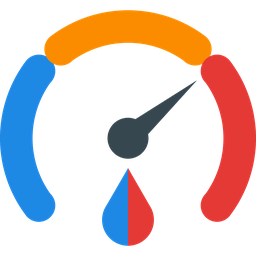

# Messdienst24 (EXTERN) for Home Assistant



Custom Home Assistant integration that reads the meter values (heat, warm water,
cold water) from the tenant portal **[legacy.messdienst24.de](https://legacy.messdienst24.de/)**
operated by EXTERN Messdienst GmbH - including the full reading history.

> Unofficial project, not affiliated with EXTERN Messdienst GmbH. The portal has
> no public API, so this integration logs in like a browser and parses the HTML.
> Changes to the portal may break it.

_Deutsch: Inoffizielle Integration, die die Zählerstände (Heizung, Warmwasser,
Kaltwasser) inkl. Historie aus dem Mieterportal von messdienst24 in Home
Assistant holt._

## Features

- One device + sensor per meter, with the current reading:

  | Meter type  | Unit | Device class | Icon                    |
  |-------------|------|--------------|-------------------------|
  | Heat        | kWh  | `energy`     | `mdi:radiator`          |
  | Warm water  | m³   | `water`      | `mdi:water-thermometer` |
  | Cold water  | m³   | `water`      | `mdi:water`             |

  Attributes: `ablesedatum` (date of the reading in the portal),
  `zaehlerart`. Zero readings in the portal are treated as missing data; the
  sensor keeps showing the last valid reading.
- **Full history import into the sensor's long-term statistics**: the sensors
  have `state_class: total_increasing`, and the reading history from the portal
  is imported once per meter into the statistics of the sensor entity. Usable
  in the Energy dashboard and in statistics graph cards.
- After the import, Home Assistant records the statistics itself: new readings
  are counted at the time they are fetched, not on the reading date.
- Data cleanup during import: leading zero readings are skipped, small drops
  (portal corrections) are ignored, large drops (annual reset) are treated as a
  meter reset.
- Config flow (UI setup) and re-authentication when the password changes.
- Polls every 6 hours (the portal only publishes new readings a few times per
  month).

## Requirements

- Home Assistant **2026.3** or newer
- A tenant account (Mieterzugang) for legacy.messdienst24.de

## Installation

### HACS (custom repository)

1. HACS → ⋮ → *Custom repositories* → add
   `https://github.com/tzabbi/ha-messdienst-24`, category *Integration*.
2. Install **Messdienst24 (EXTERN)** and restart Home Assistant.

### Manual

Copy `custom_components/messdienst24` into `<config>/custom_components/` and
restart Home Assistant.

## Configuration

*Settings → Devices & services → Add integration → Messdienst24*, then enter:

- **Username / password** of the portal
- **Metering service code**: the `md` parameter from the portal URL
  (`https://legacy.messdienst24.de/?md=ex` → `ex`)

## Energy dashboard

Select the **sensors** directly - their statistics contain the imported history.

- Water meters → *Water consumption*
- Heat meter (kWh) → there is no dedicated heat category; *Gas consumption*
  (accepts kWh) works as a workaround.

Imported history appears on the reading dates; afterwards consumption appears
when a new reading is fetched (polling every 6 hours). The portal does not
provide finer data.

The imported sums are shifted so that they end at 0 when Home Assistant takes
over the recording. Old statistic values can therefore be negative; consumption
(the difference between values) is correct.

### Upgrading from 0.1.0

Version 0.1.0 stored the history as external statistics
(`messdienst24:<type>_<meter number>`). On the first start of a newer version
these are copied into the sensor statistics (including readings that are no
longer shown in the portal) and are no longer updated afterwards. Switch the
Energy dashboard and statistics cards to the sensors. Once everything looks
correct, the old statistics can be deleted under *Developer tools →
Statistics*.

The import runs only once per meter. To repeat it, delete the sensor's
statistics and remove the integration entry, then set it up again.

## Limitations

- Only tested with tenant accounts of EXTERN Messdienst (`md=ex`). Landlord
  accounts or other metering services on the same portal may have a different
  page layout.
- Meter types are detected from the portal's icons (`mbt4` heat, `mbt6` warm
  water, `mbt7` cold water). Unknown types are added without unit and without
  statistics.
- Home Assistant treats a drop of more than 10 % as a meter reset, while the
  history import uses 50 %. Drops between 10 % and 50 % after the import can
  therefore be counted as consumption by Home Assistant.
- The portal itself transmits the credentials as URL query parameters (over
  HTTPS); the integration has to do the same.

## Development / troubleshooting

The `scripts/` folder contains standalone helpers (they read
`scripts/credentials.ini`, see `credentials.ini.example`):

- `md24_discover.py` - logs in and dumps all portal pages to `scripts/dump/`
  (contains personal data, git-ignored). Useful if your account looks different.
- `test_client.py` - runs the integration's client without Home Assistant
  (`pip install aiohttp`).
- `make_brand_icon.py` - regenerates the logo (`pip install pillow`).

Debug logging:

```yaml
logger:
  logs:
    custom_components.messdienst24: debug
```

## License

MIT - see [LICENSE](LICENSE).
